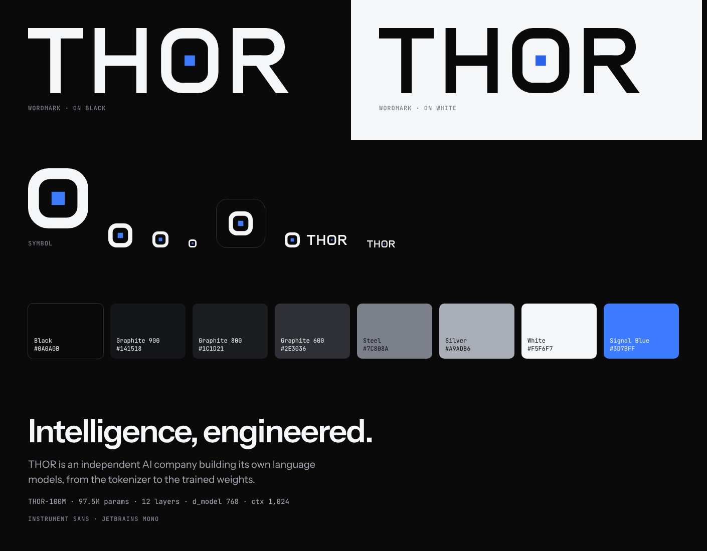

# THOR brand foundation

**Intelligence, engineered.**

THOR should read as a credible, independent deep-tech company: precise, quiet, confident. Not a game, not a crypto project, not a superhero. No lightning bolts, hammers or Norse mythology anywhere.

## Logo

| File | Use |
|---|---|
| `logo/thor-wordmark-white.svg` | Primary, on black or graphite |
| `logo/thor-wordmark-black.svg` | Primary, on white |
| `logo/thor-wordmark-mono-white.svg` / `-mono-black.svg` | Single-color contexts (print, embossing, partner pages) |
| `logo/thor-symbol-white.svg` / `-black.svg` | Favicon, avatars, small spaces |
| `logo/thor-app-icon.svg` | App and touch icons (symbol on a black tile) |

**Wordmark:** custom geometry, not a typed font. The letters sit on a 100-unit cap height with a 16-unit stem: square terminals, a flat T, an H with its bar at optical center, an R with a straight leg. The O carries the **unit**, a small Signal Blue square at its exact center. The unit is the brand's one signature detail: a single, measured element inside a precise frame.

**Symbol:** the O and its unit on their own. It holds up at 16px.

**Rules**
- Clear space on every side is at least twice the unit square (32% of the cap height).
- Minimum size: wordmark 14px tall on screen; symbol 16px.
- The unit is Signal Blue on full-color marks, or the mark color in mono versions. Never another color.
- Don't stretch, outline, rotate, add effects, re-space the letters, or retype "THOR" in a font as a logo.
- Never pair the mark with lightning, hammers, runes, or other mythological imagery.

## Color

Defined in [`tokens.css`](tokens.css).

| Token | Hex | Role |
|---|---|---|
| Black | `#0A0A0B` | Primary background |
| Graphite 900 / 800 / 700 / 600 | `#141518` `#1C1D21` `#24262B` `#2E3036` | Surfaces, cards, hairlines |
| Steel | `#7C808A` | Labels and tertiary text on black only (5.0:1); use Silver on graphite surfaces |
| Silver | `#A9ADB6` | Secondary text |
| White | `#F5F6F7` | Primary text, light backgrounds |
| Signal Blue | `#3D7BFF` | The one accent: the logo unit, focus rings, live status, primary action |
| Signal Ink | `#2A63EA` | Signal Blue on light backgrounds (4.8:1 on white) |

Roughly 90% neutrals. Signal Blue appears once or twice per view, never as a large fill or gradient.

## Typography

| Role | Typeface | Notes |
|---|---|---|
| Display and body | **Instrument Sans** (OFL-1.1) | Display: weight 600, tracking −0.035em. Body: 400, 1.6 line height |
| Specs, code, labels | **JetBrains Mono** (OFL-1.1) | Labels: uppercase, 12px, tracking +0.08em |

Both are open-source and bundled with the site; no external font requests.

## Voice

- **Precise over impressive.** "31.1M parameters, 14 layers" beats "a powerful model".
- **Understated.** Let the engineering speak; no superlatives.
- **Honest about status.** Every model, product and paper carries one of: **Planned · In development · Training · Trained (internal) · Released**. It moves forward only when it has actually happened.
- **Never claim** benchmark wins, partners, customers, funding or capabilities that aren't real and verifiable. Never compare small models to frontier LLMs.
- **Write "THOR"** in capitals. Products: THOR Models, THOR Research, THOR Studio, THOR Cloud, THOR Chat. Models: THOR-30M, THOR-100M, THOR-150M, THOR-Instruct, THOR-Embed.

## Visual language

- Dark-first: black canvas, graphite surfaces, 1px hairlines.
- Geometry from the symbol: rounded-square corners (radius 6/10/16px), square units, measured grids.
- Imagery is abstract and technical (token grids, schematics, real data), never stock photos of robots or brains.

## Trademark note

The name "THOR" is used by many existing companies and brands. Get a trademark and domain clearance search done by a qualified professional before relying on this identity commercially.
